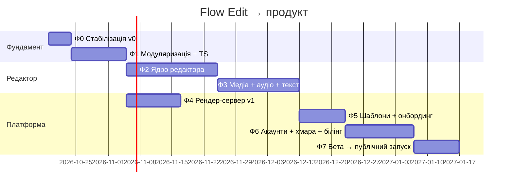

# 04 · Дорожня карта

Оцінки — для **1 full-stack розробника** (або розробник + AI-агент), у робочих днях (д).
Кожна фаза закінчується **релізом** і має **критерії готовності (DoD)**.

> Оцінки — грубі (±40 %), без буфера на баги, дизайн і роботу з відгуками. Перед Фазою 2 їх треба переоцінити.
> Діаграма нижче в **календарних** днях (так працює Mermaid) і показує порядок, а не точні дати.
> Для 1 розробника Ф4 **не** паралельна: сума = 5+12+20+18+12+10+15+10 = **102 р.д. ≈ 5–6 міс. календарних**.
> Паралельність (Ф4 ∥ Ф2–Ф3) можлива лише за двох виконавців — тоді ≈ 90 р.д.

Разом ≈ **102 робочих дні** для одного виконавця.

---

## Фаза 0 — Стабілізація v0 (5 д)
*Мета: не втрачати дані, закрити безпеку, нічого не ламати. Залишаємось в одному `index.html`.*

| ID | Задача | Закриває |
|---|---|---|
| F0-1 | Санітизація: `safeColor()` (регекс `#rrggbb`), `safeEnum()`, `num()` з clamp для всіх параметрів перед шаблоном | B1 |
| F0-2 | Валідація імпорту + невідомі типи як заглушки, зрозуміле повідомлення | B12 |
| F0-3 | Інспектор → undo (снепшот на `pointerdown`/`focus`, коміт на `change`) | B3 |
| F0-4 | `rot`/`blur` дефолти 0 у всіх пресетах | B4 |
| F0-5 | Backspace не видаляє; Delete — так; підтвердження не потрібне, бо є undo | B7 |
| F0-6 | Поле «Тривалість проєкту» + «обрізати до останнього кліпа» | B9 |
| F0-7 | Каркас `migrate()` і збереження бекапу перед міграцією | B11 |
| F0-8 | rAF-відтворення, `ResizeObserver`, прибрати витік таймера grain | B13, B15, B16 |
| F0-9 | Код рендер-сервера → у репозиторій (`server/`), README як підняти | B2 (частково) |

**DoD:** XSS-пейлоад з JSON не виконується; ручний чек-лист зі [06-QA](06-QA.md) пройдено; тег `v0.2.0`.

---

## Фаза 1 — Модуляризація + TypeScript (12 д)
*Мета: структура з [03-ARCHITECTURE](03-ARCHITECTURE.md) §3 без зміни поведінки.*

| ID | Задача |
|---|---|
| F1-1 | Vite + TS + ESLint + Prettier, pnpm workspaces |
| F1-2 | `packages/schema`: Zod-схема v1 і v2, `migrate(v1→v2)` + фікстури |
| F1-3 | `packages/engine`: `applyTime`, mount/unmount, `animateNode`, seeded — перенесення 1:1 |
| F1-4 | `packages/presets`: 14 пресетів окремими файлами, на `createElement` замість `innerHTML` |
| F1-5 | Store + команди (undo/redo з merge) |
| F1-6 | IndexedDB-персистенція + імпорт старого `localStorage` |
| F1-7 | Golden-frame тести: Playwright рендерить кожен пресет на t∈{0, 0.5, 2, 5} і порівнює PNG |
| F1-8 | CI (GitHub Actions): lint, typecheck, unit, e2e, деплой на Pages з `main` |
| F1-9 | Відносні одиниці у пресетах (передумова форматів, аудит B24) |

**DoD:** візуально ідентичні кадри v0 vs v1 (pixel diff ≤ 0.5 %); бандл ≤ 150 КБ gzip; CI зелений.

---

## Фаза 2 — Ядро редактора (20 д)
*Мета: редактор, яким зручно користуватись.*

| ID | Задача | Оцінка |
|---|---|---|
| F2-1 | **Багатодоріжковий таймлайн**: додати/перейменувати/перемістити доріжку, mute/lock/hide, z-порядок = порядок доріжок | 4 д |
| F2-2 | **Gizmo на сцені**: вибір кліком, drag, кути — масштаб, ручка — поворот, Shift — пропорції; pinch/rotate двома пальцями | 4 д |
| F2-3 | Snapping: до playhead, країв кліпів, центру/третин кадру; напрямні | 2 д |
| F2-4 | Мульти-виділення (Shift/рамка), групове переміщення, copy/paste (між проєктами через clipboard) | 2 д |
| F2-5 | **Кейфрейми**: ◆ біля поля в інспекторі, доріжка кейфреймів під кліпом, easing-пресети + bezier | 5 д |
| F2-6 | Окремі In/Out-анімації (fade, slide, scale, blur, typewriter) і `speed` для всіх | 2 д |
| F2-7 | Формати 9:16/1:1/4:5/16:9 + safe-zones (оверлей інтерфейсу Reels/TikTok) | 1 д |

**DoD:** юзабіліті-тест на 3 людях — зібрати 15-с відео з 6 шарів за ≤ 5 хв без підказок; 60 fps на Pixel 6a з 30 елементами.

---

## Фаза 3 — Медіа, аудіо, текст (18 д)

| ID | Задача | Оцінка |
|---|---|---|
| F3-1 | Ассети: завантаження зображень/відео у IndexedDB, панель «Медіа» | 3 д |
| F3-2 | Елемент **Зображення** (fit/fill, маска, фільтри) | 2 д |
| F3-3 | Елемент **Відео** (детермінований seek `video.currentTime` + `requestVideoFrameCallback`) | 3 д |
| F3-4 | **Аудіо-доріжка**: waveform, trim, gain, fade in/out, синхрон часу через AudioContext | 4 д |
| F3-5 | Аудіо-реактивність: аналіз амплітуди офлайн (`OfflineAudioContext`) → крива → прив'язка до параметра | 2 д |
| F3-6 | Текст 2.0: Google Fonts (кураторський набір, self-hosted), багаторядковий, обведення, фон-плашка, анімація по словах/літерах | 3 д |
| F3-7 | Субтитри: імпорт SRT → набір текстових кліпів | 1 д |

**DoD:** відео з музикою, фото і титрами експортується з синхроном звуку ±1 кадр.

---

## Фаза 4 — Рендер-сервер v1 (12 д, паралельно Ф2–Ф3)

| ID | Задача |
|---|---|
| F4-1 | Node API за контрактом [03 §8](03-ARCHITECTURE.md#8-рендер-сервер), Zod-валідація, ліміти |
| F4-2 | Черга BullMQ/Redis, воркери, скасування, retry |
| F4-3 | Захоплення кадрів через CDP, стрим у FFmpeg, мікс аудіо |
| F4-4 | Шардинг кадрів між вкладками; бенчмарк |
| F4-5 | S3-сховище результатів, TTL, presigned upload ассетів |
| F4-6 | Docker Compose, домен + TLS (Caddy), Sentry, метрики (Prometheus/Grafana або Uptime Kuma) |
| F4-7 | Rate-limit, анонімні токени, CORS лише з продакшн-домену |

**DoD:** 30 с 1080p ≤ 60 с; 50 рендерів підряд без помилок; падіння воркера не губить задачу.

---

## Фаза 5 — Шаблони та онбординг (10 д)

| ID | Задача |
|---|---|
| F5-1 | Формат шаблону = `FlowDoc` + слоти (`{{quote}}`, `{{author}}`, `{{music}}`) |
| F5-2 | 12 шаблонів: цитата дня, дихальна практика (4-7-8 з таймером), молитва, афірмація, анонс події, музичний візуалізатор, ... |
| F5-3 | Стартовий екран: «Почати з шаблону / Порожній / Останні проєкти» |
| F5-4 | Інтерактивний тур (5 кроків) при першому вході |
| F5-5 | Нові візуали: аврора, хвилі, боке, світлячки, мандала, геометрія, дощ, сніг (≥ 8) |
| F5-6 | Палітри та «стиль проєкту» (змінити всі кольори одним кліком) |

**DoD:** від відкриття до експорту з шаблону ≤ 3 хв (медіана тесту на 5 людях).

---

## Фаза 6 — Акаунти, хмара, білінг (15 д)

| ID | Задача |
|---|---|
| F6-1 | Auth (Supabase Auth / Firebase Auth): email-magic-link + Google + Apple |
| F6-2 | Хмарне збереження проєктів і ассетів, синхронізація з локальними (last-write-wins + конфлікт-копія) |
| F6-3 | Тарифи і ліміти (див. [02 §6](02-PRODUCT.md#6-монетизація-)), водяний знак для Free |
| F6-4 | Stripe Checkout + Customer Portal, вебхуки → права |
| F6-5 | Сторінки: лендінг, ціни, privacy, terms, impressum (DE) |
| F6-6 | Публічне посилання-прев'ю проєкту (read-only) |

**DoD:** повний шлях реєстрація → оплата → рендер без знака працює в продакшні.

---

## Фаза 7 — Бета і запуск (10 д)

- Закрита бета 30–50 авторів, канал зворотного зв'язку (Telegram-група), щотижневі релізи.
- PWA: встановлення, офлайн-редагування.
- i18n en, перевірка доступності, Lighthouse ≥ 90.
- Product Hunt / Telegram / Instagram-кампанія з відео, зробленими в самому Flow Edit.

**DoD:** метрики з [02 §7](02-PRODUCT.md#7-метрики-успіху) збираються; crash-free ≥ 99.5 %.

---

## Ризики

| Ризик | Ймовірн. | Вплив | Пом'якшення |
|---|---|---|---|
| CSS-фільтри (`blur`) вбивають fps на мобільних | висока | високий | ліміт blur, перехід важких візуалів на Canvas/WebGL, quality-режим прев'ю |
| Розбіжність прев'ю і рендера (шрифти, Safari vs Chromium) | середня | високий | self-hosted шрифти, golden-frame тести, рендер завжди в Chromium |
| Вартість серверного рендера | середня | середній | черга з пріоритетами, ліміти Free, клієнтський WebCodecs-експорт |
| iOS Safari: WAAPI/IndexedDB/аудіо обмеження | середня | середній | ранні тести на iPhone з Ф1 |
| Один розробник — бус-фактор | висока | високий | ця документація, ADR, тести, AGENTS.md |
